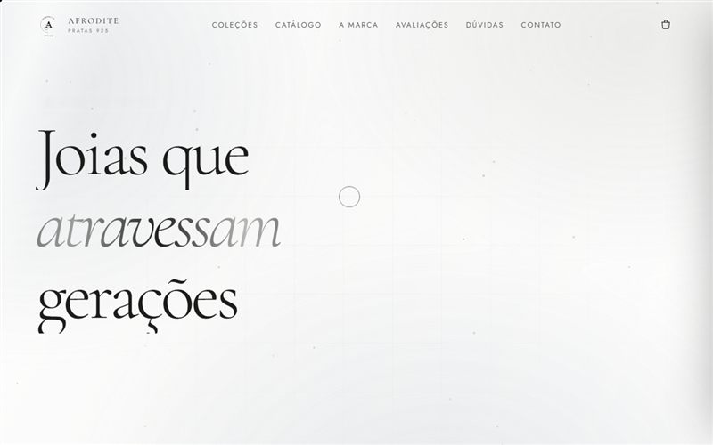
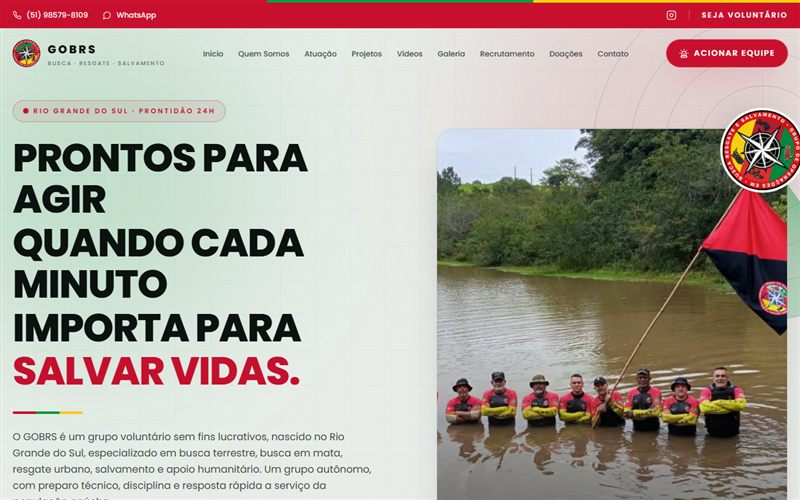
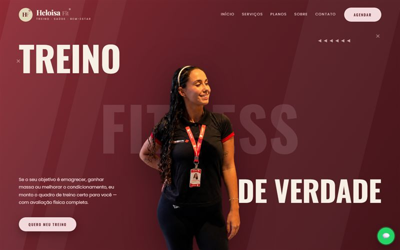
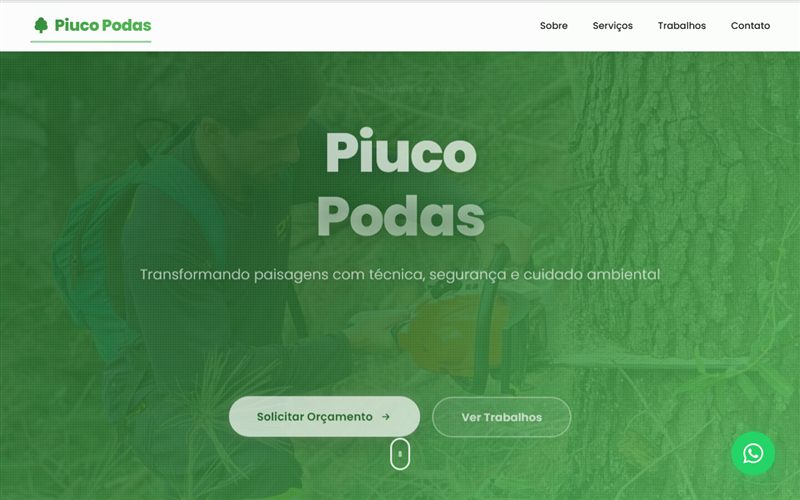

  

  
  
  

---

## 👨‍💻 Sobre mim

Sou formado em **Análise e Desenvolvimento de Sistemas** pela FADERGS e crio sites rápidos, responsivos e pensados primeiro para o celular. Seis deles já estão no ar para clientes reais, de catálogo de joias a site de grupo de resgate.

Gosto de cuidar do que o usuário sente: página que carrega rápido, navegação simples e um caminho direto até o contato.

- 🔭 Buscando minha **primeira vaga como Desenvolvedor Júnior** (Front-end, Back-end ou Full Stack)
- 💼 Antes do desenvolvimento, fui **estagiário de suporte técnico de TI** na FuelTech
- 🌎 Inglês intermediário

## 🛠️ Tecnologias

  <b>Front-end</b>  
  

  <b>Back-end e banco de dados</b>  
  

  <b>Ferramentas e qualidade</b>  
  

## 🚀 Projetos para clientes

<table>
  <tr>
    <td width="50%" valign="top">
      
      <h3>Use Afrodite Pratas</h3>
      
Catálogo de joias em prata 925 com filtro, busca, carrinho e pedido pelo WhatsApp. Carga inicial reduzida de 1,8 MB para 170 KB.

      
<code>HTML</code> <code>CSS</code> <code>JavaScript</code>

      <a href="https://use-afrodite-pratas.vercel.app">🌐 Ver site</a> · <a href="https://github.com/Rangel202/use-afrodite-pratas">💻 Código</a>
    </td>
    <td width="50%" valign="top">
      
      <h3>GOBRS</h3>
      
Landing page de um grupo voluntário de busca, resgate e salvamento do RS, com acionamento rápido por ligação e WhatsApp.

      
<code>Next.js</code> <code>React</code> <code>TypeScript</code> <code>Tailwind</code>

      <a href="https://site-gobrs.vercel.app">🌐 Ver site</a> · <a href="https://github.com/Rangel202/site-gobrs">💻 Código</a>
    </td>
  </tr>
  <tr>
    <td width="50%" valign="top">
      
      <h3>Raasch</h3>
      
Site institucional e catálogo de joias, iluminação e decoração, com conteúdo migrado do site antigo e venda pelo WhatsApp.

      
<code>Next.js</code> <code>React</code> <code>TypeScript</code> <code>Tailwind</code>

      <a href="https://site-raasch.vercel.app">🌐 Ver site</a> · 🔒 Código privado
    </td>
    <td width="50%" valign="top">
      
      <h3>Mestre das Tintas</h3>
      
Site de pintura residencial e comercial com animações e foco em levar o visitante ao pedido de orçamento.

      
<code>HTML</code> <code>CSS</code> <code>JavaScript</code> <code>GSAP</code>

      <a href="https://mestre-das-tintas-mu.vercel.app">🌐 Ver site</a> · 🔒 Código privado
    </td>
  </tr>
  <tr>
    <td width="50%" valign="top">
      
      <h3>Heloisa Fit</h3>
      
Site de personal trainer com serviços, planos e agendamento pelo WhatsApp.

      
<code>HTML</code> <code>CSS</code> <code>JavaScript</code>

      <a href="https://heloisa-fit.vercel.app">🌐 Ver site</a> · <a href="https://github.com/Rangel202/heloisa-fit">💻 Código</a>
    </td>
    <td width="50%" valign="top">
      
      <h3>Piuco Podas</h3>
      
Site de serviços de poda de árvores com galeria de trabalhos, depoimentos e pedido de orçamento.

      
<code>HTML</code> <code>CSS</code> <code>JavaScript</code>

      <a href="https://rangel202.github.io/Piuco-Podas/">🌐 Ver site</a> · <a href="https://github.com/Rangel202/Piuco-Podas">💻 Código</a>
    </td>
  </tr>
</table>

## 🎓 Projetos acadêmicos

| Projeto | O que é | Tecnologias |
|---|---|---|
| [**Gestão de Atendimentos**](https://github.com/Rangel202/Gestao_atendimentos) | Sistema de registro e gestão de atendimentos, com API REST e front-end | Node.js · Express · Sequelize · MySQL · JavaScript |
| [**Automação de Testes FGTAS**](https://github.com/Rangel202/gestao_atendimento_FGTAS) | Testes automatizados de login, CPF/CNPJ e perfis de usuário, em equipe | Java · Selenium · JUnit · TestNG |
| [**API SDM**](https://github.com/Rangel202/api_sdm_25_2) | API REST com cidades, clientes, produtos e pedidos | Node.js · Express · MySQL |

## 📫 Vamos conversar?

Estou aberto a vagas e a conversas sobre projetos. O melhor caminho é pelo [**LinkedIn**](https://www.linkedin.com/in/gabriel-puchivailo-rangel-7a9675304/).

